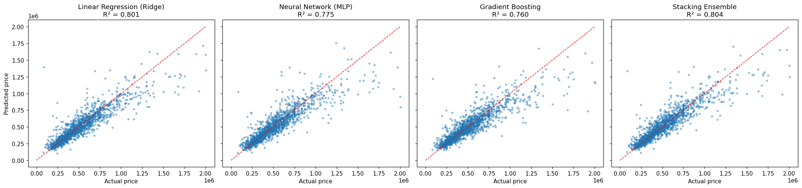
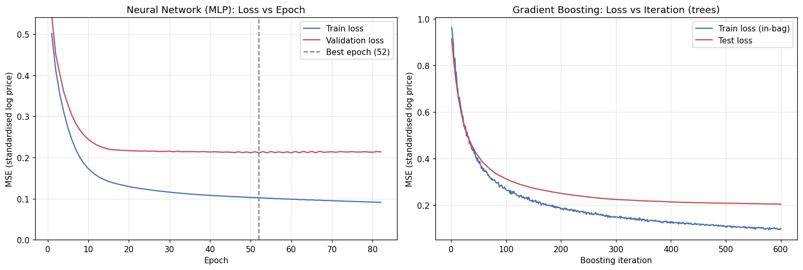
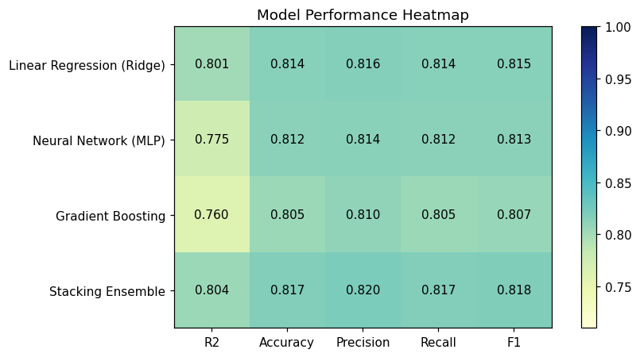
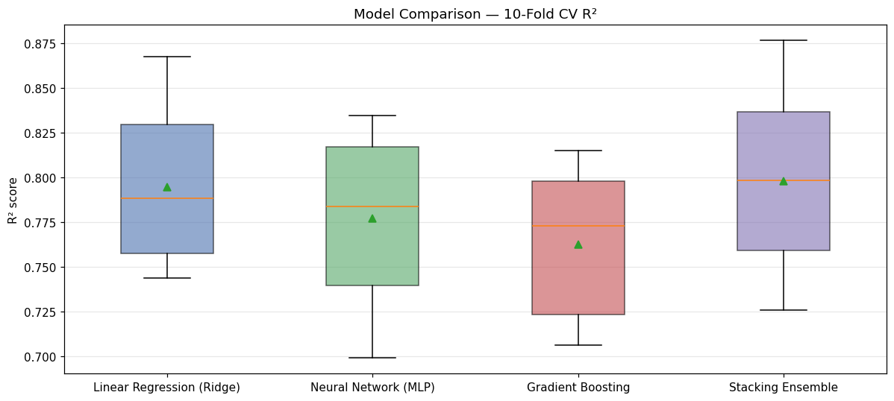
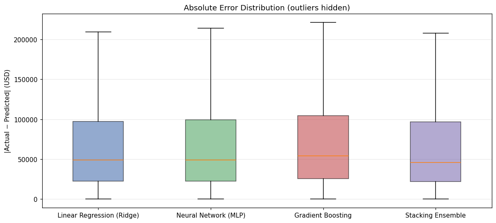
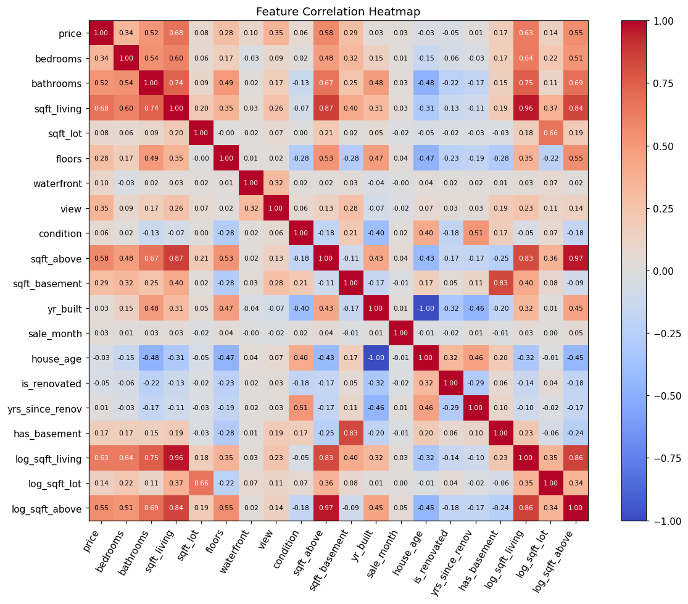
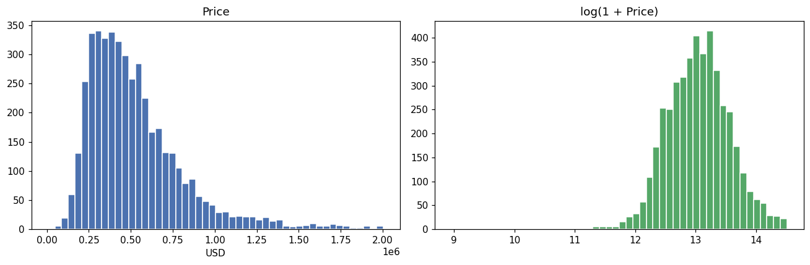
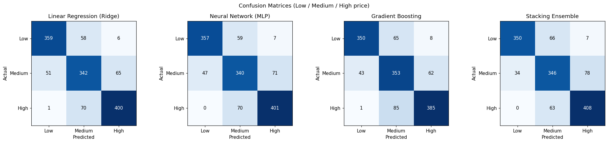
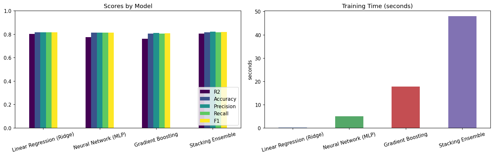

# 🏠 House Price Prediction: Regression Model Comparison & Stacking Ensemble


An end-to-end machine learning pipeline that predicts residential sale prices in Washington State (USA). It compares a **linear model**, a **neural network** and a **gradient-boosted tree model**, then combines all three in a **stacking ensemble**. The ensemble scores **R² = 0.804** on the held-out test set.

<p align="center">
  
</p>

## 📊 Results

Evaluated on a 30% held-out test set (1,352 houses).

| Model | R² ↑ | MAE ↓ | RMSE ↓ | Band Accuracy | Band F1 | Train Time |
|---|---:|---:|---:|---:|---:|---:|
| Linear Regression (Ridge) | 0.801 | $79,150 | $127,004 | 0.814 | 0.815 | 0.13 s |
| Neural Network (MLP) | 0.775 | $81,576 | $135,049 | 0.812 | 0.813 | 5.0 s |
| Gradient Boosting | 0.760 | $86,789 | $139,624 | 0.805 | 0.807 | 17.7 s |
| **Stacking Ensemble** | **0.804** | **$77,855** | **$126,148** | **0.817** | **0.818** | 47.9 s |

**10-fold cross-validated R² on the training set:** Stacking 0.798 ± 0.048 · Ridge 0.794 ± 0.045 · MLP 0.777 ± 0.049 · Gradient Boosting 0.763 ± 0.041

**Key takeaways**
- After careful feature engineering and a log-transformed target, a regularised **linear model is nearly as accurate as the ensemble**, and it trains about 370× faster.
- The **stacking ensemble** gives the best result on every metric, because its Ridge meta-learner combines what the three base models get right.
- The tree and neural models start to **overfit** on a dataset this small (about 4.5k rows). The loss curves below show the gap between training and validation loss.

> **About the "band" metrics:** price is continuous, so accuracy and F1 are calculated after grouping true and predicted prices into **Low / Medium / High** bands. The band edges are the 33rd and 66th percentiles of the *training* prices ($365k and $565k).

## 🔬 Approach

```
data.csv ──► Cleaning ──► Feature Engineering ──► 70/30 Split ──► ColumnTransformer ──► 4 Models ──► Evaluation
             • drop price=0   • house age             (seed 42)     • StandardScaler       Ridge
             • drop top 1%    • renovated flag                      • OneHotEncoder        MLP (custom epoch loop)
             • dedupe         • years since renovation              (city, zipcode)        Gradient Boosting
                              • sale month, zipcode                                         Stacking (Ridge meta)
                              • log(sqft) features
                              • log-transformed target (TransformedTargetRegressor)
```

**Engineering highlights**
- **Leak-free pipelines.** All preprocessing sits inside scikit-learn `Pipeline`s, so scalers and encoders are fitted on training folds only.
- **Custom `EpochMLP` estimator.** It is a scikit-learn-compatible wrapper that trains `MLPRegressor` one epoch at a time, records train and validation loss, and keeps the best weights (early stopping with patience). The test set is never used for model selection.
- **Target transform.** The model learns `log(price)`, which reduces skew. Predictions are converted back to dollars automatically.
- **Stacking.** Out-of-fold predictions from the three base models feed a Ridge meta-learner.

## 📈 Visualisations

| Training dynamics | Model performance |
|---|---|
|  |  |
| **Cross-validation stability** | **Error distribution** |
|  |  |

<details>
<summary><b>More figures: EDA, confusion matrices, training time</b></summary>






</details>

## 📁 Dataset

`data.csv` contains **4,600 house sales** from King County and the surrounding area in Washington State (May–July 2014), with 18 columns: price, bedrooms, bathrooms, living and lot area, floors, waterfront, view, condition, year built and year renovated, and location (street, city, state/zip).

After cleaning (removing zero prices, the top 1% of outliers, and duplicates), **4,505 rows** remain.

## 🚀 Run It

```bash
git clone https://github.com/nabilah-hossain-ruba/house-price-prediction.git
cd house-price-prediction
pip install -r requirements.txt
jupyter notebook house_price_prediction.ipynb
```

The full notebook runs in a few minutes on a laptop CPU. The 10-fold cross-validation of the stacking model takes the longest.

## 🗂️ Project Structure

```
├── house_price_prediction.ipynb   # Full pipeline: EDA → preprocessing → models → evaluation
├── data.csv                       # Dataset (4,600 rows)
├── images/                        # Figures exported from the notebook
└── requirements.txt
```

## 🧰 Tech Stack

Python · pandas · NumPy · scikit-learn (Pipeline, ColumnTransformer, Ridge, MLPRegressor, GradientBoostingRegressor, StackingRegressor) · Matplotlib

---

*Built for CSE422 (Artificial Intelligence) at BRAC University.*
